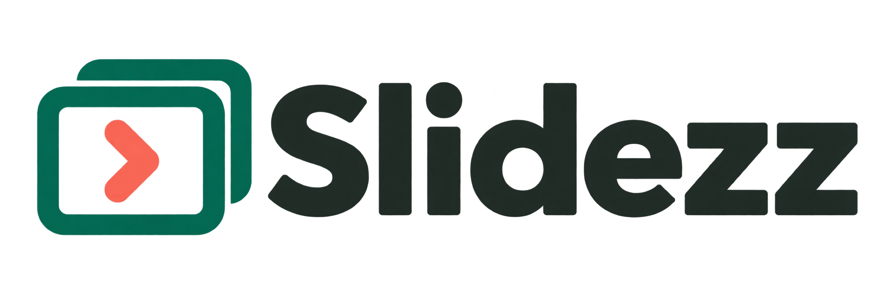
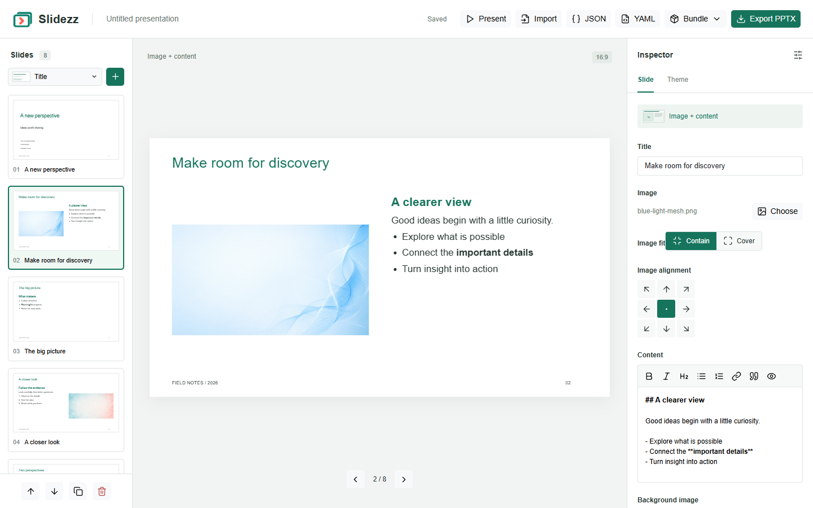

# Slidezz





A local Python web app for composing editable, widescreen PowerPoint presentations.
Bootstrap 5, EasyMDE and Lucide are bundled locally; no CDN or external requests
are needed while using the app.

## Run

### No Backend

Build the standalone editor with `python tools/build_static.py`, then open
`dist/slidezz.html` directly in a browser. No Python,
HTTP server, CDN or network connection is required. It includes the same templates,
Markdown editors, theme controls, gallery selection and JSON/YAML/ZIP import/export.
Changes are saved in browser storage; exporting a ZIP is the portable way to keep
or share them. PPTX generation and individual image uploading remain features of the
Python app. Offline users can add gallery images by importing a ZIP bundle.

From the Python app, **Bundle > Standalone HTML** downloads the current deck as a
self-contained editor with its images, fonts and libraries. **Bundle > ZIP with images**
downloads `presentation.json`, referenced `images/`, an image-link `manifest.json`,
and the standalone editor as `index.html`. Unzip it and open `index.html` to edit offline.
Missing referenced images are listed in the manifest and remain placeholders.

The Import dialog accepts these ZIPs in both app versions. Image filename collisions
are resolved without replacing existing gallery files. ZIP imports are limited to
32 MB compressed / 64 MB uncompressed and 256 files.

To rebuild the standalone editor from the example deck:

```sh
python tools/build_static.py
# Or choose a deck and destination:
python tools/build_static.py --presentation examples/presentation.json --output dist/slidezz.html
```

### Python App

Requires Python 3.10 or newer.

```sh
python -m venv .venv
# Windows PowerShell:
.venv\Scripts\Activate.ps1
# macOS / Linux:
# source .venv/bin/activate
python -m pip install -r requirements.txt
python -m flask --app backend.app:create_app run --host 127.0.0.1 --port 5000
```

Open http://127.0.0.1:5000. This is a local, single-presentation editor, without
accounts or collaboration. Bind to localhost when running it on your computer.

## Demo And Manual

Build the 28-slide manual with the command below and open `dist/slidezz-manual.html`
without a backend, or import
[its JSON source](examples/manual.json) into the Python editor. The manual covers
all eight layouts, Markdown, image fit/alignment, themes, geometry, fonts,
JSON/YAML/ZIP imports, offline bundles, PPTX export and presentation mode.
It includes actual editor screenshots and an intentional missing-image example.

Press **Present** to show the selected slide. Navigate with arrow keys, Page Up /
Down, Space, Home or End. Use fullscreen where supported; Escape or
**Back to editor** returns to editing at the current slide.

Rebuild its screenshots and JSON, YAML, HTML, ZIP, PPTX and PDF exports with:

```sh
python tools/build_manual.py
```

This verification build needs the dev dependencies, Microsoft Edge and LibreOffice.
It uses isolated presentation storage and never replaces your current saved deck.
Outputs are written to `dist/slidezz-manual.*`.

The original `blue.jpg` and `smoke.jpg` have been replaced with generated backgrounds.
Old deck references are mapped to `blue-light-mesh.png` and `smoke-blue-blush.png`.

## Editing

Six free font families are bundled locally: Lato, Fira Sans, PT Sans, PT Serif,
Barlow and IBM Plex Mono. Each includes regular, bold, italic and bold italic.
Choose one in the Theme tab; the browser loads its TTF files without external requests.
**Download fonts (TTF)** downloads the fonts and their SIL Open Font License files.
Install the TTFs on computers opening exported PowerPoint files to prevent font
substitution. PPTX records the selected font family; fonts are not embedded.
Existing system font options and imported font names remain supported.

Font assets and licenses live in `frontend/fonts/`. To refresh them, run
`python tools/vendor_fonts.py`. The manifest records the Google Fonts commit,
which is reused on subsequent runs for reproducible downloads.

- Choose a template and press +. Select slides in the left panel.
- Edit fields in the right inspector. Markdown fields have formatting and preview controls.
- Use arrows or drag slides to reorder them; copy duplicates the selected slide.
- Open an image field's gallery to upload or select PNG, JPEG or WebP images.
  Uploads are validated, limited to 16 MB per request and stored under unique names.
- Change font, colors and footer in the Theme tab.
- Theme also configures left/right/top/bottom margins, column gap, panel padding,
  footer bottom margin (in inches), and title/subtitle/body sizes (in points).
  These values reposition panels consistently in preview and PPTX, and are included
  in theme JSON and presentation JSON/YAML exports. The column gap applies to
  two-column, image/content and two-image layouts.
- **Export theme JSON** in the Theme tab downloads the current configuration as
  `theme.json`, including changes not yet autosaved. Use this object as the
  `theme` property in another presentation's JSON.
- Changes are automatically saved to `storage/presentations/current.json`.
  Wait for the Saved indicator before closing the page.
- Export PPTX downloads the current presentation, including changes still awaiting autosave.
  Text and images are native, editable PowerPoint objects.
- JSON or YAML downloads the deck structure. Import accepts a file or pasted source and
  replaces the deck only after validation succeeds.
- Bundle exports include referenced images, so they can be moved to another computer.

YAML uses the same `theme` and `slides` structure as JSON. Choose YAML in the import
dialog for pasted source; `.yaml` and `.yml` files select it automatically.
Markdown content can use YAML literal blocks:

```yaml
theme:
  font_name: Lato
  primary_color: "#16745C"
slides:
  - type: content
    title: The big picture
    markdown: |
      ## What matters

      - Clear goals
      - **Meaningful** progress
```

YAML imports use PyYAML's safe loader and the same validation as JSON.
Use JSON-compatible values and string mapping keys; custom tags, dates and recursive
aliases are rejected. Colors beginning with `#` must be quoted.

Templates: title, content, image + content, content + image, two images,
two columns, quote and section divider. Slides use a 16:9 canvas.
The template picker and inspector show SVG panel diagrams generated from each
template's layout geometry. New templates automatically receive matching icons.
Missing gallery images display `Image <name> not found` in both preview and export.
Each image pane offers **Contain** (the full image) or **Cover** (crop to fill),
with eight edge/corner alignments plus center. Settings are independent for each pane
and apply to preview and PowerPoint. JSON stores them beside the image filename as
`image_fit` and `image_alignment` (or `left_image_fit`, `right_image_alignment`, etc.).
Fit values are `contain` and `cover`; alignments are `top_left`, `top`, `top_right`,
`left`, `center`, `right`, `bottom_left`, `bottom`, and `bottom_right`.
Existing decks default to contain/center. For slides with a background image, the
content panel has a selectable color and a transparency slider (0% opaque to 100%
transparent). The Theme tab configures panel color/transparency, text and footer
colors, in addition to the accent and slide background. Panel defaults are white
and 50% transparency. Each slide inherits the panel settings unless its **Use theme**
checkbox is cleared. Re-enable it to remove the override. Existing explicit slide
settings remain overrides. These settings affect only
the panel, leaving text and pane images opaque, and apply to both preview and PPTX.
JSON uses `background_panel_color` (hex color) and
`background_panel_transparency` (number from 0 to 100) in the theme, with optional
same-named properties on slides. Omit slide properties to inherit the theme.
Theme text and footer colors use `text_color` and `footer_color`.

Markdown supports paragraphs, headings, bold, italic, links, bullet and numbered
lists, quotes and code. Raw HTML is displayed as text; unsafe link schemes are removed.
Use image fields for gallery images. Preview warns when text exceeds its box;
shorten the content or split it into more slides before exporting. Font substitution
and line wrapping can vary between browsers, PowerPoint and LibreOffice.

## JSON Format

```json
{
  "theme": {
    "font_name": "Aptos",
    "primary_color": "#16745C",
    "background_color": "#FFFFFF",
    "footer_text": "Project review"
  },
  "slides": [
    {
      "type": "title",
      "title": "A new perspective",
      "subtitle": "Ideas worth sharing",
      "author": "Your team"
    },
    {
      "type": "image_left_content",
      "title": "A closer look",
      "image": "blue-light-mesh.png",
      "markdown": "## What matters\n\n- Clear goals\n- **Meaningful** progress"
    }
  ]
}
```

Images are referenced by their gallery filename, not embedded in JSON.
Share the corresponding files from `images/` alongside a deck's JSON.
Missing optional fields become empty strings. Invalid templates, field types,
colors or presentations over 200 slides are rejected with an explanatory error.
`examples/presentation.json` contains all eight templates.

## Add A Template

Register a `LayoutTemplate` in `backend/templates/registry.py`:

```python
register(LayoutTemplate(
    "takeaway", "Takeaway",
    [
        field("title", default="Key takeaway"),
        field("message", "markdown", "Message", "One **clear** idea."),
    ],
    [
        box("title", "text", .65, .45, 12, .85, 30),
        box("message", "markdown", .65, 2, 12, 4, 26),
    ],
))
```

`field(name, type, label, default)` declares the editable schema. Supported types
are `text`, `markdown` and `image`. The browser creates one form control per field,
including independent Markdown editors for templates with multiple rich text fields.
Image fields used in pane layouts automatically gain fit and alignment choice controls.
`box(field, kind, x, y, width, height, font_size)` defines geometry in inches
on a 13.333 x 7.5 inch slide; font sizes are points. Keep boxes above the footer
at y=7. The browser and PPTX renderer both use this layout.
Restart the server to load the new template. No frontend template switch is needed.

## Tests And Visual Checks

```sh
python -m pip install -r requirements-dev.txt
python -m pytest -q
python -m playwright install chromium
python tests/verify_browser.py
```

Alternatively use an installed browser with `python tests/verify_browser.py --channel msedge`
or `--channel chrome`.

The browser check starts an isolated test server and exercises editing, reordering,
JSON import, uploading and downloading, and captures desktop/mobile screenshots.
It also exports every template to `test-results/all-templates.pptx`.
To verify the no-backend editor, first build it and run
`python tests/verify_static.py`. This opens the file directly and checks editing,
browser persistence, bundle round trips and responsive views with zero HTTP requests.
To verify the actual PowerPoint rendering with LibreOffice installed:

```sh
python tests/render_pptx.py
```

This converts the exported deck to PDF and writes a contact sheet plus individual
slide images into `test-results/`. The README screenshot is generated by the
browser check and saved as `docs/editor.png`.

Vendored libraries retain their own licenses under `frontend/vendor/`.
To refresh the pinned local assets, run `python tools/vendor_assets.py`
(requires network access). Application source is licensed under [MIT](LICENSE).
